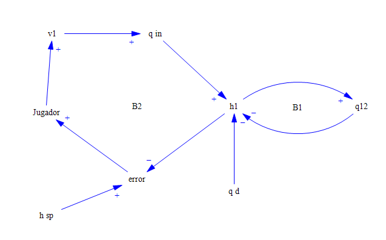
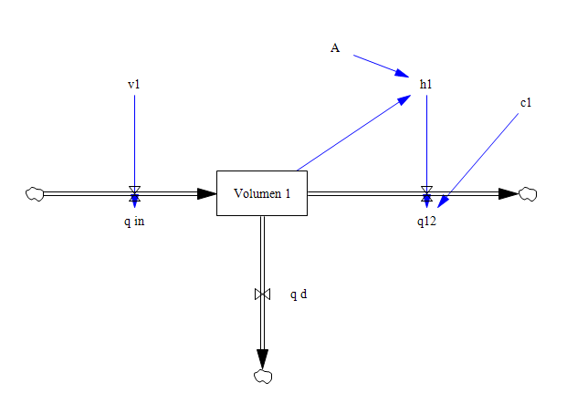
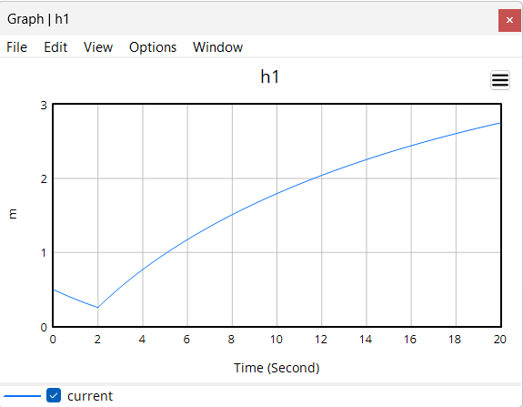

# Modelo de Alambique Real: El Arte de la Alquimia

## Variables (tabla entrada-proceso-salida con unidades)

| Tipo de variable | Símbolo | Significado en el juego | Unidad | Rango |
|---|---|---|---|---|
| Entrada (gesto) | u(t) = v₁(t) | Apertura de la válvula de entrada (altura de la mano derecha) | adimensional | 0 a 1 |
| Entrada (gesto) | v₂(t) | Apertura de la válvula de salida del alambique 2 (pellizco de la mano izquierda), solo en el nivel 3 | adimensional | 0 a 1 |
| Perturbación | d(t) = q_d(t) | Consumo del caldero real; se resta del último alambique en uso | m³/s | Nivel 2: 0 o +0,08; nivel 3: ±0,04 senoidal |
| Estado(s) | x(t) = h₁(t), h₂(t) | Nivel de líquido en cada alambique | m | 0 a 3 (a 3 m desborda) |
| Salida (lo que se ve) | y(t) | Nivel controlado: h₁ en los niveles 1 y 2, h₂ en el nivel 3 | m | 0 a 3 |
| Referencia | r(t) = h_sp | Nivel objetivo de cada nivel del juego | m | 1,5 / 1,0 / 1,2 → 0,8 |

Diagrama entrada-proceso-salida:

```
v₁ (mano derecha) → [Actuador: saturación 0–1, 0,25 1/s] → q_in = 0,4·v₁
     → [Alambique: A·dh/dt = q_in − c·√h − q_d] → h (visor y tendencia de la HMI)
                              ↑
                         q_d (consumo)
```

## Diagrama causal y de Forrester (capturas de Vensim, ciclos R y B)



| Desde | Hacia | Polaridad |
|---|---|---|
| v₁ | q_in | + |
| q_in | h₁ | + |
| h₁ | q₁₂ | + |
| q₁₂ | h₁ | − |
| q_d | h₁ | − |
| h_sp | error | + |
| h₁ | error | − |
| error | Jugador | + |
| Jugador | v₁ | + |

- **B1 (autorregulación del alambique):** h₁ → (+) q₁₂ → (−) h₁. Más nivel produce más salida por el orificio, y eso baja el nivel.
- **B2 (jugador en el lazo):** h₁ → (−) error → (+) Jugador → (+) v₁ → (+) q_in → (+) h₁. Más nivel reduce el error; el jugador cierra la válvula y el nivel baja.
- No hay ciclos de refuerzo (R): el sistema es autorregulado.



- **Nivel:** Volumen 1 = V₁ (m³), con h₁ = V₁/A.
- **Flujos:** q_in = 0,4·v₁ (entrada), q₁₂ = c₁·√h₁ (salida por el orificio), q_d (consumo).
- **Auxiliares:** h₁, v₁. **Constantes:** A = 1 m², c₁ = 0,2 m^2,5/s.
- **Simulación:** v₁ = STEP(1, 2), 20 s, paso 0,01 s, integración Runge-Kutta 4 Auto en Vensim PLE 10.5.2 (la versión PLE no incluye RK4 Fixed; los resultados se guardan cada 0,01 s) → `docs/vensim_escalon.csv`.



- Resultado: h₁ baja de 0,50 a 0,26 m entre 0 y 2 s (válvula cerrada, el alambique se vacía por el orificio: autorregulación B1); al abrir la válvula a los 2 s sube a 1,80 m a los 10 s y a 2,75 m a los 20 s.

## EDO y punto de operación (linealización si aplica)

Niveles 1 y 2 (un alambique):

A·dh₁/dt = 0,4·v₁ − c₁·√h₁ − q_d

Nivel 3 (dos alambiques en cascada):

A·dh₁/dt = 0,4·v₁ − c₁·√h₁

A·dh₂/dt = c₁·√h₁ − c₂·v₂·√h₂ − q_d

Parámetros: A = 1 m², c₁ = c₂ = 0,2 m^2,5/s, q_in,máx = 0,4 m³/s.

**Modelo de referencia (tabla 5.3 d, fila 1):** se usan sin cambios los parámetros de la guía (A = 1 m², c₁ = c₂ = 0,2 m^2,5/s, q_in = 0,4·v₁ m³/s, v₁ y v₂ de 0 a 1 con velocidad máxima de 0,25 1/s, altura máxima 3 m). La única adaptación es dónde se resta q_d: la ecuación de referencia lo resta del tanque 2, pero en los niveles 1 y 2 solo existe el alambique 1, así que se resta de h₁, como indica el prompt del simulador ("se resta del último tanque en uso").

Verificación de unidades: c·√h = (m^2,5/s)·(m^0,5) = m³/s; dividido entre A (m²) da m/s, que son las unidades de dh/dt. ✔

**Punto de operación** (equilibrio: dh₁/dt = 0 con q_d = 0):

0,4·v₁₀ = c₁·√h₀  →  v₁₀ = c₁·√h₀ / 0,4

**Linealización** (serie de Taylor de primer orden de √h alrededor de h₀):

√h ≈ √h₀ + (h − h₀)/(2√h₀)

Con Δh₁ = h₁ − h₀ y Δv₁ = v₁ − v₁₀:

A·dΔh₁/dt = 0,4·Δv₁ − (c₁/(2√h₀))·Δh₁

Multiplicando por 2√h₀/c₁:

τ·dΔh₁/dt + Δh₁ = K_v1·Δv₁,  con τ = 2A√h₀/c₁,  K = 2√h₀/c₁  y  K_v1 = 0,4·K

| Nivel | h₀ (m) | v₁₀ | τ (s) | K (s/m²) | K_v1 (m) |
|---|---|---|---|---|---|
| 1 | 1,5 | 0,612 | 12,25 | 12,25 | 4,90 |
| 2 | 1,0 | 0,500 | 10,00 | 10,00 | 4,00 |
| 3, tramo A (h₂₀ = 1,2 m, v₂₀ = 1) | 1,2 | 0,548 | 10,95 | 10,95 | 4,38 |
| 3, tramo B (h₂₀ = 0,8 m, v₂₀ = 1) | 0,8 | 0,447 | 8,94 | 8,94 | 3,58 |

Arranque del nivel 1: h₁ = 0,5 m, en equilibrio con v₁ = 0,354.

## Función de transferencia G(s)

Transformada de Laplace con condiciones iniciales nulas (variables de desviación):

τ·s·ΔH₁(s) + ΔH₁(s) = K_v1·ΔV₁(s)

G(s) = ΔH₁(s)/ΔV₁(s) = K_v1 / (τ·s + 1)

- Nivel 1 (h₀ = 1,5 m): **G(s) = 4,90 / (12,25·s + 1)**
- Nivel 2 (h₀ = 1,0 m): **G(s) = 4 / (10·s + 1)**
- Nivel 3, de v₁ a h₂ (tramo A): **G(s) = 4,38 / (10,95·s + 1)²** (segundo orden: dos alambiques en serie)

## Espacio de estados: A, B, C, D

Un alambique (x = Δh₁, u = Δv₁, y = Δh₁):

A = −c₁/(2·A·√h₀),  B = 0,4/A,  C = 1,  D = 0

- Nivel 1 (h₀ = 1,5 m): A = −0,0816 s⁻¹, B = 0,4 m/s, C = 1, D = 0
- Nivel 2 (h₀ = 1,0 m): A = −0,1 s⁻¹, B = 0,4 m/s, C = 1, D = 0

Cascada, nivel 3 tramo A (x = [Δh₁, Δh₂], u = [Δv₁, Δv₂], y = Δh₂; h₁₀ = h₂₀ = 1,2 m, v₂₀ = 1):

```
A = [[-0,0913,  0      ],      (s⁻¹)
     [ 0,0913, -0,0913 ]]

B = [[ 0,4,  0      ],         (m/s)
     [ 0,   -0,2191 ]]

C = [0, 1]
D = [0, 0]
```

con a₁₁ = −c₁/(2A√h₁₀), a₂₁ = c₁/(2A√h₁₀), a₂₂ = −c₂·v₂₀/(2A√h₂₀), b₁₁ = 0,4/A y b₂₂ = −c₂·√h₂₀/A.

## Polos, estabilidad y respuesta esperada al escalón

- Nivel 1: polo s = −1/τ = −0,0816 s⁻¹. Nivel 2: s = −0,1 s⁻¹. Nivel 3 (tramo A): polo doble s = −0,0913 s⁻¹.
- Todos los polos tienen parte real negativa → el sistema es **estable** (y autorregulado, ciclo B1).
- Respuesta al escalón de primer orden (sin sobreimpulso, Mp = 0 %):
  - Valor final del cambio: Δh = K_v1·Δv₁.
  - En t = τ alcanza el 63,2 % del cambio final.
  - Tiempo de establecimiento (criterio del 2 %): ts ≈ 4τ → **49 s en el nivel 1** y **40 s en el nivel 2**.
- Respuesta al escalón de segundo orden (nivel 3, v₁ → h₂, tramo A): G(s) = 4,38/(10,95·s + 1)² = K·ωn²/(s² + 2ζωn·s + ωn²)
  - ωn = 1/τ = 0,0913 rad/s; ζ = 1 (críticamente amortiguado, polos reales iguales).
  - Mp = 0 % y tp no existe (no hay pico: la respuesta sube sin oscilar).
  - ts (2 %) ≈ 5,83/ωn ≈ 64 s; valor final Δh₂ = 4,38·Δv₁.
  - Efecto de v₂ sobre h₂ (primer orden): K_v2 = −2·h₂₀/v₂₀ = −2,4 m, con τ₂ = 10,95 s.
- Por la no linealidad, τ crece con √h: el alambique responde más lento cuanto más lleno está.
- Respuesta no lineal esperada en Vensim (v₁ = STEP(1, 2), h₁ inicial = 0,5 m): h₁ ≈ 0,26 m a los 2 s y ≈ 2,75 m a los 20 s, subiendo hacia el equilibrio de 4 m (en el juego desbordaría a los 3 m).

## Niveles: parámetros, perturbaciones y criterio de cada nivel (copia en docs/niveles.md)

| | Nivel 1. El Primer Destilado | Nivel 2. La Demanda del Caldero Real | Nivel 3. El Elixir Doble en Cascada |
|---|---|---|---|
| Objetivo | Llevar h₁ de 0,5 a 1,5 m y mantenerlo | Mantener h₁ en 1,0 m | Mantener h₂ en 1,2 m y bajarlo a 0,8 m a los 75 s |
| Perturbaciones y parámetros | Un alambique, sin perturbaciones | Un alambique; consumo escalón de +0,08 m³/s entre los 40 y los 80 s | Dos alambiques; consumo senoidal de ±0,04 m³/s con período de 40 s |
| Criterio para superarlo | 30 s seguidos en ±10 % (máx. 120 s) | 80 % del tiempo en ±5 % y sin alarma HH (120 s) | 70 % del tiempo en ±5 % y sin desbordar ningún tanque (150 s) |

Alarmas: H = 2,4 m, HH = 2,8 m; desborde a 3,0 m (fin de la partida).

## Escala física → pantalla (por ejemplo 1 m = 100 px)

El nivel se lee en el visor de vidrio de cada alambique: el fondo del visor es 0 m y su parte superior es 3 m (la altura máxima, donde desborda), así que 1 m = (alto del visor en px) / 3. En la misma escala se dibujan el líquido, la banda de tolerancia, la referencia y las marcas de alarma H (2,4 m) y HH (2,8 m), y a la derecha del visor va una escala de 0 a 3 m. Al principio se había previsto 1 m = 100 px (300 px para 3 m), pero con el arte de Gemini (sección 5.8) el nivel se muestra dentro del visor del dibujo, que es más pequeño.

## Verificación del modelo (sección 5.9 a)

### Pruebas unitarias (`npm test`)

| Sistema probado | Método | Paso h (s) | Error máximo | ¿Pasa? |
|---|---|---|---|---|
| Primer orden (K = 2, τ = 0,5 s) | RK4 | 1/120 | 3,5·10⁻¹⁰ | Sí |
| Primer orden (K = 2, τ = 0,5 s) | Euler | 1/120 | 4,5·10⁻³ | No (supera 1·10⁻⁴; solo se compara) |
| Segundo orden (ζ = 0,3, ωn = 4 rad/s) | RK4 | 1/120 | 1,3·10⁻⁸ | Sí |
| Segundo orden (ζ = 0,3, ωn = 4 rad/s) | Euler | 1/120 | 2,2·10⁻² | No (supera 1·10⁻⁴; solo se compara) |
| Modelo del juego (alambique, escalón de Vensim de 20 s) | RK4 | 1/120 | 5,1·10⁻⁶ m | Sí |

Con el mismo paso, RK4 es entre un millón y diez millones de veces más exacto que Euler (1,7·10⁶ en segundo orden y 1,3·10⁷ en primer orden). Por eso el juego integra con RK4.

### Escalón del juego frente a Vensim y frente al cálculo de la sección 5.3

- **Prueba:** el alambique empieza en equilibrio en h0 = 1,5 m (v1 = 0,612372). A los 2 s el mando de v1 sube 0,01 (a 0,622372), y la válvula sigue esa orden con su velocidad máxima de 0,25 1/s. La prueba dura 80 s.
- **Por qué un escalón pequeño:** así se compara con la linealización alrededor de 1,5 m. El escalón de la sección 5.3 (v1 de 0 a 1) desborda el alambique a los 26,6 s y nunca se estabiliza.
- **Archivos:**
  - `docs/juego_escalon.csv`: partida con `?control=escalon`.
  - `docs/vensim_escalon_verificacion.csv`: simulación de `vensim/alambique_escalon_verificacion.mdl` (RK4 Auto, TIME STEP 0,01 s).
  - `docs/verificacion_escalon.png`: gráfica de las dos curvas y del modelo lineal.

| Magnitud | Juego | Vensim | Cálculo a mano (5.3) | Diferencia juego–Vensim | Diferencia juego–5.3 |
|---|---|---|---|---|---|
| Valor final h1 (m) | 1,5493 | 1,5493 | 1,5490 (1,5 + K_v1·0,01) | 0,00 % | 0,6 % del cambio |
| Cambio Δh1 (m) | 0,0493 | 0,0493 | 0,0490 | 0,0 % | 0,6 % |
| τ (63,2 %, medido desde t = 2 s) | 12,36 s | 12,37 s | 12,25 s | 0,1 % | 0,9 % |
| ts (2 %, desde t = 2 s) | 47,5 s | 47,5 s | 47,9 s (τ·ln 50) | 0,0 % | 0,9 % |

- **Error máximo entre las curvas del juego y de Vensim:** 1,1·10⁻⁴ m, que es el 0,2 % del cambio.
- **Resultado:** todas las diferencias quedan por debajo del 2 %, así que el modelo del juego **verifica**.
- **Por qué el τ medido es un poco mayor que el de la 5.3:**
  - la válvula tarda 0,04 s en subir 0,01;
  - en un modelo no lineal, τ = 2A√h/c crece con el nivel (a 1,55 m vale 12,45 s).
